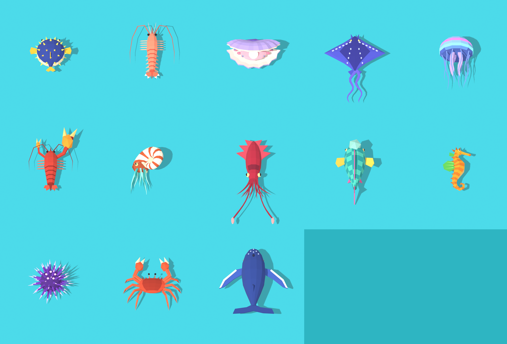

# Creature concept models (#66–#80)

Thirteen static low-poly models, one per creature concept issue, built 2026-11-12. They are **concept models awaiting approval**: none is rigged, animated or used by the game. Mechanics for these creatures are still unapproved.



| Creature | Issue | Size (cells, X × Y) | Verts / faces | Look |
|---|---|---|---|---|
| [Bubble Puffer](../creature-bubble-puffer/) | #66 | 3.1 × 3.0 | 354 / 394 | Round navy puffer, cream belly, gold spikes |
| [Skipping Shrimp](../creature-skipping-shrimp/) | #67 | 3.3 × 5.1 | 443 / 402 | Slender salmon shrimp, plated abdomen, fan tail, long antennae |
| [Pearl Oyster](../creature-pearl-oyster/) | #68 | 4.0 × 2.4 | 636 / 750 | Ridged lavender shells gaping south, pink body, glowing pearl |
| [Ribbon Ray](../creature-ribbon-ray/) | #69 | 4.5 × 6.4 | 509 / 701 | Indigo diamond ray, dashed spots, two trailing ribbons |
| [Drum Jelly](../creature-drum-jelly/) | #71 | 2.5 × 4.6 | 417 / 417 | Bell-first jellyfish, glowing bands, oral arms and tentacles |
| [Pistol Shrimp](../creature-pistol-shrimp/) | #72 | 3.6 × 5.7 | 386 / 384 | Stocky red shrimp, one oversized gold claw held open |
| [Whirlpool Nautilus](../creature-whirlpool-nautilus/) | #73 | 2.4 × 3.8 | 906 / 670 | Striped spiral shell rolled towards the camera, teal tentacles |
| [Crown Squid](../creature-crown-squid/) | #74 | 3.2 × 7.8 | 477 / 527 | Crimson squid, crown of fin points, two clubbed tentacles |
| [Boulderhead Parrotfish](../creature-boulderhead-parrotfish/) | #76 | 2.8 × 4.9 | 288 / 327 | Teal checkered parrotfish, boulder forehead, cream beak |
| [Gardener Seahorse](../creature-gardener-seahorse/) | #77 | 2.1 × 4.0 | 331 / 378 | Orange seahorse in side profile, leaf-green fins |
| [Puffer Urchin](../creature-puffer-urchin/) | #78 | 3.4 × 3.2 | 602 / 680 | Purple urchin, pale-tipped spines, glowing crown plates |
| [Mason Crab](../creature-mason-crab/) | #79 | 4.3 × 4.5 | 320 / 336 | Wide red crab, two heavy claws ahead, eight jointed legs |
| [Echo Whale](../creature-echo-whale/) | #80 | 5.0 × 6.0 | 307 / 402 | Humpback-like whale, pale-edged flippers, broad flukes |

## Building

`kit.py` holds the shared helpers (lofted bodies, tubes, faceted balls, cones, thin slabs, shell segments, flat materials, GLB export and the validation render). In Blender:

```python
ASSETS = "<repo>/prototypes/sushi-loop/assets"
exec(open(ASSETS + "/creature-bubble-puffer/source/build_model.py").read())
shoot(ASSETS + "/creature-bubble-puffer/validation/game-view.png", span=8.4, res=(600, 680))
```

## Conventions

- X right, +Y north (the travel direction), Z up, 1 unit = 1 cell. Fronts face north, except where the animal really travels backwards (squid, nautilus and jelly lead with the mantle, shell or bell) and the oyster, which gapes south at the ship.
- Flat-shaded, one material per colour, named `<creature>_<part>`. Glow parts (pearl, jelly bands, urchin plates) have emission for the engine to drive.
- The Gardener Seahorse lies in side profile and the Nautilus shell is rolled 52°, so the pursuit camera sees their silhouettes.

## Not done

- Rigs and clips (the Inkfin's clip set is the model to follow once an attack is approved).
- HUD icons, hit shapes, recipes, and any Godot integration.
- Sizes are first guesses; none was checked in the HTML preview or on the map.
