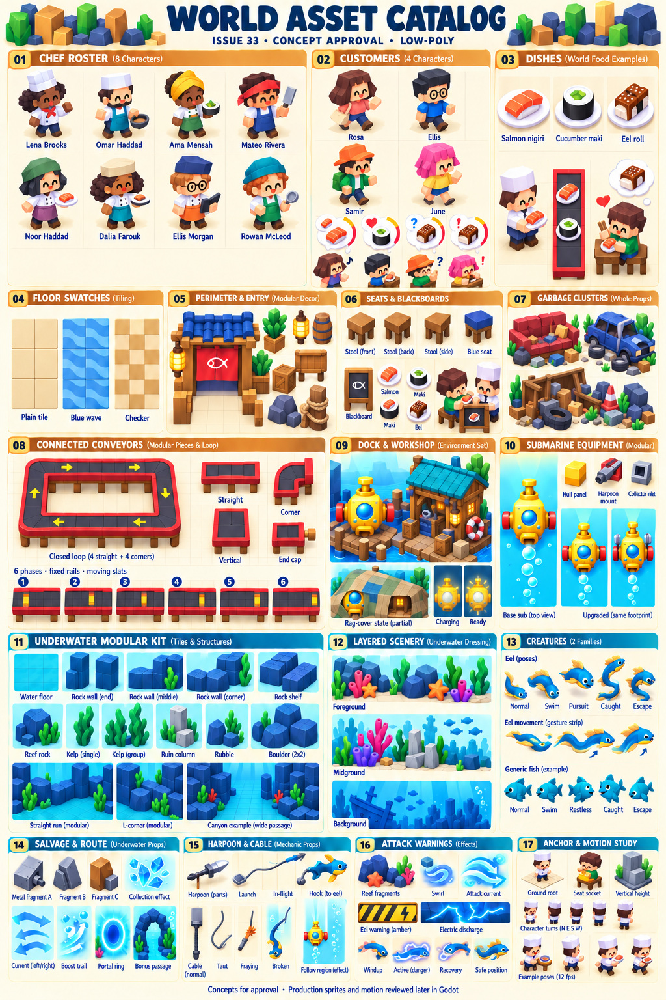

# Issue 33 world asset catalog — concept approval

Status: **Awaiting user approval of the concept sheet and inventory.** Issue #33 remains open. No production model, sprite, animation or Godot preview is represented as complete by this sheet.

Base: latest `origin/main` verified through GitHub on 2026-10-17, `c7160c598d97023b7503339771fe7e1e8e48d45f`. Work branch: `codex/sushi-loop-33-art-catalog`. The existing main checkout and its local changes were preserved.

Authority: [current art direction](../../art-directions/README.md), [issue #33](https://github.com/yiochen/game-prototype/issues/33), the supplied three generation/projection skills, and the user's explicit Godot Android request. The 2026-10-17 follow-up moves issue #33 catalog review onto the live wireframe site; the game target remains Godot Android. The current low-poly direction supersedes the issue's historical doodle wording. The issue's world-asset scope is retained; the asset-review implementation is adapted to the browser wireframe site.

The numbered sheet establishes proposed colors, silhouettes, identities and material vocabulary. It is not a registered sprite sheet. Its diagrammatic poses, joins, projection and motion samples are illustrative; exact square-cell geometry, attachments, complete directional sets, animation continuity and layering must be demonstrated using the actual reusable sprites on the wireframe site before final approval. Do not crop this board into production sprites.

## Item inventory

| Family ID | Sheet panels | Items to author | Required presentation coverage |
| --- | --- | --- | --- |
| W01 restaurant-floor | 04 | Plain cream tile, Blue wave, Checker; restrained matching repetition variants | Seamless square repetition; static alternative for any subtle flare |
| W02 perimeter-entry | 05 | Finished entry, wall middles/corners/end caps, plants, barrels, crates, lanterns, blank sign, subdued rocks, dock posts/rope | Outer perimeter only; entrance open; lantern ambient loop; no new access mechanic |
| W03 seats | 06, 17 | Backless honey-wood stool, blue-seat cosmetic concept | N/E/S/W where visually needed; stable ground root and explicit seat socket; occupied composition |
| W04 conveyors | 08 | Four directed straights, eight directed corners (two valid flows for each of four geometries), four facing start caps and four facing open/end caps | Running, frozen and scrubbed; touching strips, all compatible joins, closed loop and independent routes; dishes separate and allowed to remain stationary over moving deck |
| W05 chefs | 01, 17 | Lena Brooks, Omar Haddad, Ama Mensah, Mateo Rivera, Noor Haddad, Dalia Farouk, Ellis Morgan, Rowan McLeod | Every identity N/E/S/W × idle/inactive, work, completed-dish hold, load-to-facing-belt; hand/dish sockets; no invented walking or separate station |
| W06 chef-blackboards | 06 | Within-cell board/base and Salmon nigiri/Cucumber maki/Eel roll selection artwork | Four-facing registration, selected/idle, local recipe-change shake |
| W07 customers | 02, 06, 17 | Current review identities Rosa, Ellis, Samir, June; four proposed looks, not a final progression roster | N/E/S/W × walk, stand/wait, seated/wait, eat; sit/stand transitions, happy bounce, restless, puzzled, panic/slow wandering; arrive/leave reuse walk |
| W08 dishes-feedback | 02, 03, 06 | Salmon nigiri, Cucumber maki, Eel roll; dish-preference/timer, happy, puzzled and panic bubbles; coin icon | Matching held/belt/seat/bubble art, appearance/fade and happy transition, manually set circular timer fill, coin pop without amount |
| W09 garbage | 07 | Whole broken sofa, wrecked car, collapsed shelving with distinct supporting rubbish and separately declared integer-cell masks | Normal/highlighted, clearance scatter/fade and clean-floor reveal; never repeated per-cell debris stamps |
| W10 dock-workshop | 09 | Yellow sub, hut to its right, shared 3×3 dock floor, entry pieces, patchwork cover and peek holes | Covered/uncovered, charging/ready, restrained ready headlight pulse; no charge calculation or UI timers |
| W11 underwater-terrain | 11 | Turquoise square floor; connected rock/canyon, shelf, reef and wreck modules; middles, edges, corners, ends; boulder and broken-column forms | Water static/scroll; integer-cell and half-width barriers, runs longer than viewport, continuous ship-sized gap; no invented mines/gates/spike mechanics |
| W12 underwater-decor | 12 | Foreground rocks/coral/starfish; midground coral/kelp/ruin fragments; quieter background rocks, wreck and fish silhouettes; bubbles/light | Separate nonblocking metadata/layers; restrained ambient loops; keep actors/pickups/hazards readable |
| W13 submarine-equipment | 10 | Recognizable yellow ship, hull panels, harpoon mount, collector inlet, baseline/upgraded appearance assemblies | Same dock/dive identity; clear upward overhead dive view, idle/travel, impact/protection; fixed bounds/pivot; no new stats/inertia/knockback |
| W14 salvage-route | 14 | Metal fragment variants, lateral current cues, boost/trail, portal rim/entry, safe bonus-passage scenery | Pickup shimmer/attraction/collection, current flow, boost glow/trail, portal idle/entry; presentation only |
| W15 creatures | 13 | Eel and current generic fish example only; no invented final species list | Swim/aim, restless, hook, pursuit, caught pose/short world clip, escape; weaving/dash/pause gestures with stable hit silhouette |
| W16 harpoon-cable-follow | 15 | Separate projectile, ship/creature sockets, normal/taut/fraying/broken cable, faint vertical following strip | Launch/flight/hook, cable loops/break; open-ended vertical strip at creature x; no grace countdown, return arrow or resistance HUD |
| W17 attack-warnings | 16 | Reef fragments, swirls, lateral attack currents, amber diagonally hatched eel strip/lightning symbol, electrical discharge | Windup/active/recovery, composed safe following position; no damage, attack scheduling or new hazard mechanics |

Excluded from this milestone: full HUDs, controls/dialogs, recipe material panels, Shop/Workshop paper pages, receipts/results backgrounds and full-screen catch cutscenes. The small world catch pose/clip remains included.

## Production contract after concept approval

- Use `generate-blender-characters`: concept → real editable Blender MCP mesh/materials → rig/poses → fixed-camera transparent capture. Retain `.blend`, modeling script, rig/camera metadata, original frames and actual model/pose validation views. No generic mannequin substitutions.
- Use `generate-block-tiles`: SVG geometry reference + imagegen for standard floors/blocks; Blender MCP model/capture + required imagegen surface refinement for complex objects. The user's requested Blender authoring applies to complex objects including the connected animated conveyor, with square-floor/reference helpers used for calibration. Retain all editable sources and raw renders/refinements.
- Environment projection is exactly `screenX = anchorX + cellSize*x`, `screenY = anchorY + cellSize*(depth-height)`. Blender axes: x=X, depth=-Y, height=Z. Use 45° orthographic environment capture with √2 vertical projection stretch before capture. Never stretch finished sprites.
- People use a separate ordinary orthographic art camera, starting around 35° elevation, without vertical stretch. Declare any rounded-prop camera exception. Share ground roots/cell scale and explicit seat/hand/surface sockets.
- Start with 128px logical cells and fixed 192×320 character/object frames, root (96,248), enlarging complete frames for clearance rather than fitting silhouettes. Render original captures at 4× scale (768×1280 for that frame); choose documented uniform runtime sampling after phone review. Flat floor is 128×128/root (64,64). No bitmap upscaling or per-pose framing.
- All animations use 12 fps, at least six unique frames per animated clip, normally 12–24 for looping actions. One-shot duration and frame count remain adjustable. Static assets are declared static. Exclude duplicate closing poses from exported loops.
- Build conveyor geometry and animation as one connected system, then export registered straight/corner/cap modules with matching ports, deck period and time phase. Animate deck/slats, keep structural rails fixed, and transport a separate plate along a manually driven preview path. Show stationary plates on running corners/endpoints too. No T/cross splits or merges. Exact seam/frame correctness cannot be inferred from this concept drawing.
- Manifest includes stable ID, native/export dimensions, direction/state mapping, integer footprint/mask, root, visual overflow, layers, ports, sockets, source hashes, frame order and timing. Keep art bounds separate from blocking metadata.
- Prepare the skill evaluation suites before production generation. Record structural and independent visual results, including failed attempts. The present concept board is not a passing production eval.

## Live wireframe-site approval milestone

After concept approval, create a wireframe-site sprite review catalog with asset/state/facing selection, play/pause/scrub, grid/footprint/root/port overlays, reduced-motion states and scene panning. Use the same reusable sprites/renderers in isolated entries and the following manually staged compositions:

1. Furnished starter restaurant and continuous expanded three-panel restaurant, occupied seats, perimeter dressing, garbage, covered/uncovered dock.
2. Belt seam room: empty touching horizontal/vertical strips in four flows, every directed corner join, starts/ends, closed loop, then repeated with independent/stationary dishes. Inspect native phone and close-up frames with overlays off.
3. Underwater travel, encounter and safe bonus passage with joined long obstacles, submarine/equipment, eel/generic creature, salvage, layered decor and all warning/cable states.

Presentation time drives clips only. No service, pathfinding, cooking/occupancy simulation, purchases, progression, rewards, charge/capture timers or save-game behavior. Deliver actual phone/wider-window screenshots, loop recordings and a live preview link for scene-asset approval. Preserve wireframes and other prototypes. **Do not close #33 until the user has approved the full scene assets on the live wireframe site.**

## Concept sources

Generated with the built-in imagegen tool, not CLI fallback. [Initial prompt](concept-prompt.txt), [refinement prompt](refinement-prompt.txt), [source record and hashes](generation-record.json). The unmodified initial result is retained as `world-asset-catalog-v01.png`; the proposed approval image is `world-asset-catalog-v02.png`. All four input references are copied unchanged into `references/`.

The refinement addressed tapered belt geometry, empty-deck slat motion studies, food vocabulary, cable/following strip, dock-cover/readiness cues and upward submarine orientation. Generated concept geometry remains approximate. The production milestone must prove the exact projection, seamless animation, attachment placement and readable phone-scale poses using actual assets.

## Current live-review entry

The wireframe route is `#art-catalog`, with the complete sheet and a 17-family browser. This first page is concept review only. Final issue acceptance will use actual animated sprites and tiled compositions on the same site, rather than requiring a Godot/Android catalog build. The Android game implementation remains a later integration target.
