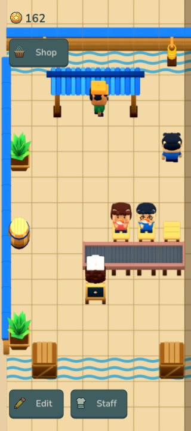

# Issue 10 · approved catalog integration

The art catalog PR [#34](https://github.com/yiochen/game-prototype/pull/34) is merged into `main` at `fbcfef76c3fb4032cfdeee19d8ca1a16160b6354`. This continuation rebases [PR #32](https://github.com/yiochen/game-prototype/pull/32) onto that commit and implements only [#10](https://github.com/yiochen/game-prototype/issues/10). The user verified this slice; PR #32 was merged into main at `d30f3cbe8b5f590c162e719828d9e605ecd24150` on 2026-10-19, closing issue #10. The original release evidence below is retained unchanged.

## Playable starter

One chef automatically prepares salmon nigiri and loads an open four-module conveyor. Three customers can occupy their own adjacent seats; guests walk in, sit, wait empty-handed, eat salmon, pay once and leave. A sale adds the recipe's fixed 14 coins and shows a local coin animation without an amount. The endpoint retains its dish, a full route blocks the upstream dishes and the chef holds at most one finished dish. Blocked progress does not accumulate and jump ahead when a vacancy opens. Shop, Edit and Staff are visible disabled controls reserved for later tickets.

The foreground game advances by elapsed time through the public `GameSession` boundary. Layout, economics and timing remain in `content/starter.json`. Snapshots preserve coins, chef preparation/loading, customers' meals/poses, dishes and partial movement, camera, random state and fractional simulation time. Home, Android Back and reopening use the same save boundary; suspended time earns no offline income.

Fresh games have a seven-column, 13-row restaurant view and a four-tile entrance. Two-axis panning reveals the continuous larger world while HUD controls stay fixed. Existing 0.1.1 saves retain their layout, coordinates and economics while adopting the current seven-column presentation. Their previously invisible blocked-belt movement clock is normalized once; valid partial crossings remain intact. A real legacy JSON fixture covers this migration.

## Approved art and editable source

The base subset contains **28 catalog objects, 139 original atlases and 1,473 complete frame contexts**, byte-identical to the approved production library. The game and gallery share `ArtBook` / `RestaurantView`, full authored canvases, 128 px logical tile pitch and ground roots. Environment projection stays at 70%; C125 characters keep the ordinary 35° camera. Native Faceted surface shading, lower shading, matte wood and muted conveyor rails are retained. Dishes use the native deck socket and render above the conveyor.

The existing customer eating poses contained maki even when the game sold salmon. A separate native Blender derivative adds **32 atlases / 384 frames** for four customers in four facings: `eat-salmon` and `seated-wait-empty`. It preserves body geometry/actions and the approved lighting, replaces only the food-plane image with the approved salmon cutout, and hides that plane while waiting. The original approved atlases remain unchanged. Editable `.blend` files, MCP authorship receipt, native pose audit and packing receipts are in [the starter-meal source](../../../../assets/production/source/variants/starter-meals/README.md).

Synchronization and Android packaging share one exact base-catalog contract validator. Native meal variants have a separate source/receipt/pixel validator used before staging and after staging. The Android runtime allowlist contains **202 source files**, including 171 atlases; Blender projects, reviews, tests, historical art, tools and signing credentials are excluded. Runtime textures have mipmaps and are retained only while used by the current rendered scene.

## Validation

- Godot: **1,021 art checks**, **94 GameSession checks**, **26 save-store checks** and **64 native app checks** pass. Visible native app checks also run at 320×720, 1440×1000 and 1280×720.
- Android packaging: **16 checks** pass, including stale registration/regions, missing or altered source pixels and stale native variant evidence.
- Repository regressions: **189 JavaScript engine tests**, production Vite build and **36 Sushi Loop browser checks** pass. The React wireframe studio remains available.
- Independent Standards and Spec reviews at `d07856aa6c46c7dba5f020179595326b10862b14` are clear after correcting the meal identity, old-save viewport migration, blocked-conveyor recovery and packaging provenance gate. See [review record](code-review.md).
- Actual signed APK update, Android rendering, touch and lifecycle evidence: [Android validation](android/README.md).

The signed 0.2.0 / code 20 APK uses the existing package `com.yiochen.sushilooptickets`, save identity and original release certificate. It is arm64/x86_64, nondebuggable, and requests no internet permission. The build source is `d07856aa6c46c7dba5f020179595326b10862b14`; subsequent commits only add capture/review evidence. APK SHA-256: `bef1ffae2d8593a760503919c4906272a47f72e48da9590b35f0886c83a54518` (181,656,801 bytes). The combined runtime input SHA-256 is `aed968115b6a90025ad363f33235eaaa096a9be84eaa85dad013f4946090cdb5`.

Download the verified [Android APK](https://drive.google.com/file/d/1bTrVF3Amb4MT_2BZDRIXnGBUGBywNYqe/view?usp=drivesdk). It was uploaded to the requested My Drive root using the upload-drive skill, with no sharing changes. Drive readback matches the local byte length and MD5; see [upload receipt](apk-drive-verification.json).

## Native captures

These are actual Godot output at fixed public simulation times, not a recreated browser scene. Screen manifests include the matching world snapshots. The blocked capture closes the entrance through the public command and waits for backpressure; the normal starter has its entrance open.

- [Phone](phone/manifest.json): starter, walking, eating, service, full open endpoint, panned world and shared gallery.
- [Wide window](wide/manifest.json) and [landscape](landscape/manifest.json): same states with square cells and fixed HUD containment.
- [Service animation](service-loop.mp4): 120 actual native frames at 24 fps.
- [Frame registration](catalog-frame-registration.png): full 12-frame character actions and all 24 conveyor frames at a common tile scale.

