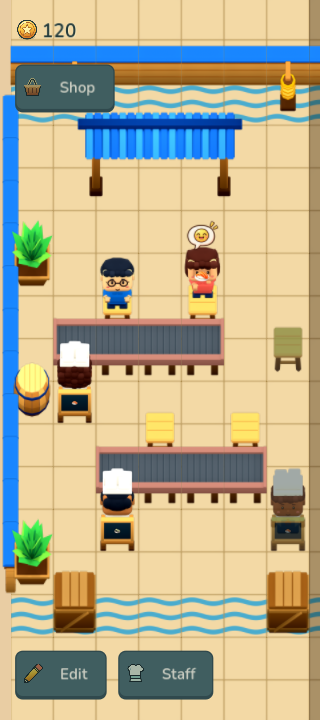

# Issue 11 · customer visits

Implements [#11](https://github.com/yiochen/game-prototype/issues/11) on the accepted #10 restaurant, based on merged `main` at `d30f3cbe8b5f590c162e719828d9e605ecd24150`. This slice remains open for user verification before the next ticket.

## Demonstration scene

The seven-column restaurant now has two separate open counters: Lena's fast salmon nigiri and Omar's slower cucumber maki. Four useful seats face their adjacent belt cells, including both retained endpoints. A disconnected chef and seat remain visibly inactive. The timing contrast intentionally makes successful preferences, expiry, restless waiting and unfed departure observable during ordinary play. These are exhibition tuning values, kept in `content/starter.json`.

Customers choose useful reachable seats from current dishes and connected chef menus, pass or yield through aisles, and show one timed first-dish preference. A match shows the 2D smiling face and short bounce; expiry accepts the next available dish. Later dishes have no new preference cycle. Hidden sampled appetite produces varied visits and similar eating times across recipes. Unfed departures charge no fine; each completed dish earns only its fixed recipe price.

Customer state, sampled meal duration/appetite, countdown, reaction age, waiting, partial walking and passing offsets survive reopening. Existing 0.1.1 and 0.2.0 saves keep their layout, coins, active food and existing visitors; future arrivals use the new visit rules. Assigned chefs need a facing belt, while customers need an accessible seat. A chef enclosed behind a counter can continue cooking.

## Android review build

The **Customer Visits** review APK uses the same game code/content as the normal release but a separate Android package, `com.yiochen.sushilooptickets.review11`. It opens the new scene in its own save sandbox and can coexist with the original app. It adds no gameplay controls or special simulation branch. Normal package `com.yiochen.sushilooptickets` remains save-compatible. Both are signed with the existing release certificate, version **0.3.0 / code 30**, arm64/x86_64, nondebuggable and offline.

Final runtime source: `0211c6bb4ad5bc6100384aa240c9383df4bc4a9d`. The sorted 257-file source-hash fingerprint is `d6e75f9dbcfabb14cb18a690f294a7f76bdf4e30b5361686d473dbcd32db9bfe`. Review staging changes only project, export and branding metadata; its fingerprint is `a1a50d375a8a8c740609c3d3634b33175ee8e74a9db7432c3d9d8038b7921bd9`.

- Review APK: 213,564,944 bytes; SHA-256 `a54bd2482e6e2df09dfe2c906eb3ac68da530a1828e4eb45420e772f67452523`.
- Normal upgrade APK: 213,560,848 bytes; SHA-256 `92a0081c35ad529dd27f97ea9f7e140b0394aaed5e610bb36a68d91781b314fd`.
- [Installed Android validation and source receipts](android/README.md).

[Download the verified Customer Visits APK](https://drive.google.com/file/d/15QpL-oLuSuFHPoCrid_LyWgLQ8PeUHEj/view?usp=drivesdk). It was uploaded to the requested My Drive root with no sharing changes; [Drive readback](apk-drive-verification.json) matches its local size and MD5.

## Art and shared presentation

The runtime base contains **31 objects / 180 exact approved atlases**. Separate derivatives add 32 customer meal atlases, eight Omar cucumber hold/load atlases and four smiling-face feedback atlases. Total: **224 atlases / 2,493 complete frame contexts**. Character and feedback animations retain 12 frames at 12 fps; connected belts retain 24 frames. C125 ordinary-35° characters, 70% environments, fixed logical roots, native Faceted shading and matte materials remain unchanged.

The chef food derivative was authored through Blender MCP and saved as an editable project with capture/audit receipts in [chef-cucumber](../../../assets/production/source/variants/chef-cucumber/README.md). The happy face was edited with the built-in ImageGen tool from the approved heart-bubble reference; the unmodified raster, exact prompt and hashes are in [customer-feedback](../../../assets/production/source/variants/customer-feedback/README.md). Both preserve every approved base source pixel. A single registered canvas is retained across all animation frames. The native scene and gallery share the same rendering and feedback helpers.

## Validation

- **76 customer-visit**, **94 session**, **26 save-store** and **12 exhibition-scene** checks pass through the public session boundary.
- **1,356 art checks** and **76 native app checks** pass. Visible native UI checks pass at 320×720, 1440×1000 and 1280×720; native reopen checks cover active preference, happiness, expiry and restlessness.
- **22 Android packaging checks** pass, including exact asset provenance, isolated review identity and unchanged normal source/staging behavior.
- **189 repository engine tests**, the production Vite build and **36 Sushi Loop browser checks** pass; the web studio remains available.
- The final rules reproduce all 33 captured scene snapshots and the movie's complete event history/final state: [35 capture replay checks](checks/capture-replay.log).
- Independent Standards and Spec reviews are clear after the enclosed-chef correction: [review record](code-review.md).

## Actual native captures

- [Phone](phone/manifest.json), [wide](wide/manifest.json), [landscape](landscape/manifest.json): full scene, preference/timer, smile/bounce, expiry, restless waiting, unfed departure, another completed dish in the same visit, yielding/passing, sustained service and shared gallery. Manifests retain triggering events and the corresponding public state.
- [Sixty-second service movie](customer-visits.mp4): 720 actual Godot frames at 12 fps, using seed 41 and public elapsed time. It includes both menus and the waiting/departure contrast.
- [Shared reaction gallery](phone/11-shared-reactions.png): the same guest's waiting, preference, happy, expired and restless states alongside inactive service and connected food.

The timed capture seed first reaches matching at 7.75 seconds, expiry at 27.2, restlessness at 35.35 and unfed departure at 45.35. Ordinary runs vary. There is no fullness meter, remaining-plate counter, manual cooking or extra review control in gameplay.

