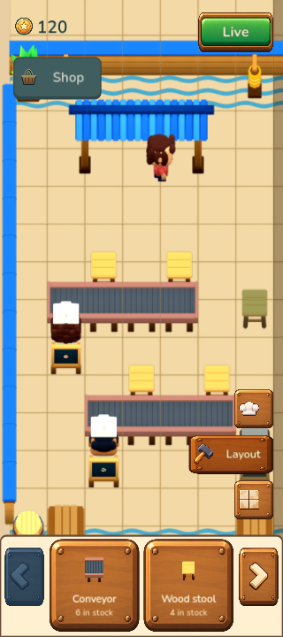

# Issue 12 · paused restaurant editor

Implements [#12](https://github.com/yiochen/game-prototype/issues/12) on **Godot Android**, from merged `main` at `7d43957282613afcd3e5f8d173007f04979ccbc9`. The final runtime is `e405297e0a4eaa8f1778a51a84ec53909eb5e321`. This slice is ready for user verification before the next ticket or merge.

## Try the editor

1. Tap **Edit**. Guests, preferences, chef work and belts pause at their exact current progress. The top-right **Live** control resumes the same restaurant.
2. Tap an object to select it, then drag that selected object to move it. Rotate or return it to inventory with the adjacent tools. Dragging an unselected object or the floor pans; swiping outside the selection deselects and pans in that gesture.
3. The **Layout** tray shows two items per page. Drag an owned item onto free floor, or select its card and tap a destination. Invalid drops return to the original arrangement with brief feedback. Fixed controls and trays reject drops consistently with the preview.
4. **People** reuses the compact three-profile roster. Tap a chef for current recipe, preparation time and assignment details; drag a profile to move or place that retained chef. Android Back closes details first, then saves and exits from the restaurant.
5. Tap the active layer to collapse/reopen its tray; switching layers opens the selected content. **Floor** currently shows the existing cream thumbnail. Cosmetic ownership and painting remain the separate floor-style ticket.
6. Close and reopen in Edit: mode, camera, selected layer, per-layer page, tray, object selection, customers and cooking/belt progress restore without advancing service.

Every accepted edit is saved immediately. There is no Save, Done, Cancel or Undo step and no coin refund for returning owned furniture. A storage-write failure blocks further mutations and presents Retry while retaining the pending arrangement in memory. Retrying writes that same arrangement rather than loading older data over it.

The two-counter restaurant from #11 is retained. Separate `content/editor.json` supplies a small owned exhibition inventory: six conveyor tiles, four stools, two plants, two crates and one barrel. Existing saves receive that inventory through a versioned migration once, preserving their restaurant and coins. Stock conservation, loaded-belt food ownership and unassigned chefs' held food/work are validated through the public session boundary.

Occupied furniture and edits that would invalidate an existing guest's path are rejected conservatively. The later customer-rescue ticket owns that recovery behavior. Route drawing, hiring, Shop purchases, development and floor painting are not introduced by this slice.

## Catalog-derived UI artwork

The [Restaurant UI & item catalog](../../../design/art-directions/restaurant-item-catalog.png) supplies button states (§5), editor icons (§6), panel materials (§8), tile boundaries (§2) and feedback (§14). Current wireframes supply control placement and behavior. Their illustrative catalog brand, Map control and sample values are not baked into production UI.

Eight transparent originals were generated with the **built-in ImageGen tool**, with the catalog provided as a style reference. Nine runtime PNGs include the generated wood and green button frames, People/Layout/Floor icons, rotation, inventory return and mirrored paging carets. Dynamic names and counts are rendered in Godot. The same presentation is used by gameplay and the native editor gallery, including slate-blue disabled states, focus, selection and pressed styling. Tray/layer motion lasts 200 ms, rail transitions 160 ms and selection feedback 140 ms, with immediate reduced-motion presentation.

- [Original rasters, packing workflow and exact prompts](../../../assets/ui/editor/v1/README.md).
- [Generation record](../../../assets/ui/editor/v1/imagegen.json), [runtime manifest](../../assets/ui/editor/manifest.json), and [provenance verification](checks/ui-provenance.json).
- [Required workflow audit for GitHub #7 and #12–31](issue-ui-contract.json). Each of the 21 issue readbacks retained its previous body/title/open state and contains the required UI-reference checklist. Game-specific `AGENTS.md` and ART-10 apply the same workflow to future UI work.

Only technical alpha registration, downsampling and caret mirroring follow generation; no artwork is repainted by the packer. Authoring rasters, prompts and reference images remain outside the APK.

## Native object rotations

Moving/rotating objects reuses exact approved #33 captures. Twenty-one missing cardinal atlases were imported for existing belt modules and movable perimeter props: **31 base objects / 201 atlases**. Every original 180 runtime atlas and the approved library manifest retain their previous hashes. No Blender geometry, lighting, projection, character proportions or source sprite pixels changed.

Together with the retained recipe, chef-food and smile derivatives, the native library has **245 atlases / 2,787 whole frames**. Conveyors keep 24-frame motion, registered deck/port joins and correct cardinal flow. [Facing and native flow verification](catalog-facing-verification.json) records this import.

## Validation

- **109 editor**, **94 session**, **76 customer-visit**, **26 save-store**, **12 demonstration** and **1,501 art** checks pass through the existing public session/time/save and art contracts.
- **120 native app checks** pass in visible 320×720, 1440×1000 and 1280×720 windows. They cover actual viewport touches, invalid overlay drops with unchanged primary/backup bytes, persistence recovery, compact paging and modal Back policy.
- **32 Android packaging checks** verify update identity, isolated review identity, exact approved native assets and ImageGen provenance before/after staging and inside the APK.
- **189 repository engine tests**, production Vite build and **35 relevant browser checks** pass. Browser results preserve the reference studio; they do not substitute for native input tests.
- Independent [Standards and Spec reviews](code-review.md) are clear. The initial selected-object tray-drop defect was fixed and independently reproduced as rejected.

Detailed logs and isolated runner receipts are in [checks/](checks/).

## Actual native captures

Each [phone](phone/manifest.json), [wide](wide/manifest.json) and [landscape](landscape/manifest.json) set contains 23 actual rendered states. The capture script verifies the selected object, moves, stock increments/decrements, rejected drops and reopened state rather than presenting manually composed fixture screenshots. The final overlay-boundary fix preserves these demonstrated actions; the new invalid-drop regressions run on all three layouts.

- [Editor layout](phone/02-edit-layout.png), [selected stool](phone/03-selected-stool.png), [valid drag](phone/06-valid-object-drag.png), [invalid drag](phone/08-invalid-object-drag.png), [rejection](phone/09-rejected-drop.png).
- [Inventory paging](phone/13-inventory-next-page.png), [People roster](phone/14-people-profiles.png), [chef inspection](phone/14b-profile-inspection.png), [collapsed tray](phone/15-collapsed-tray.png), [current Floor thumbnail](phone/16-floor-current-disabled.png).
- [Reopened Edit](phone/17-reopened-editor.png), [write failure/Retry](phone/17b-pending-save-retry.png), [resumed Live](phone/18-live-resumed.png).
- [Shared editor](phone/19-shared-editor-normal.png), [pressed layer](phone/20-shared-layer-pressed.png), [disabled roster boundaries](phone/21-shared-roster-boundary-disabled.png).

## Signed Android review build

[Install the verified Restaurant Editor APK](https://drive.google.com/file/d/1_NhXQmdoSFG4SuHJ2CGSRq9FKTpFDr-2/view?usp=drivesdk). Version **0.4.0 / code 40**, package `com.yiochen.sushilooptickets.review12`, label **Sushi Loop · Restaurant Editor**. It installs alongside the original restaurant in a separate Android save sandbox, starts the two-menu scene and adds no special gameplay commands. The normal upgrade retains `com.yiochen.sushilooptickets`, its save identity and original signer.

The uploaded review APK is **225,704,347 bytes**, SHA-256 `1f2ce2e75468dfe838e50690040053c1a8db8057f27a371218274929eebf01e3`. [Drive metadata readback](apk-drive-verification.json) matches its MD5 and size. It was uploaded to the requested My Drive root without changing sharing permissions.

Both final releases were built from runtime `e405297e0a4eaa8f1778a51a84ec53909eb5e321`. All **291 runtime source files** match that commit. The source fingerprint is `75de50c5143e21785e8b8538dca000b241f496d84911c88269de053b7b458526`; the isolated review staging fingerprint is `1ff2f1acd8b8ac42478aaa660f3583c0f977dbbf51091ca3244a3a585f030c4a`. Only branding/project/export metadata differ between normal and review staging. Both are offline, nondebuggable, arm64/x86_64, retain the original release signer and request no Android permissions.

[Actual Android validation](android/README.md) includes **35 real touch/platform checks** and **five complete saved-state comparisons**. Normal 0.3.0→0.4.0 update preserves primary/backup bytes before first launch; review installation and editing leave that normal save untouched. The new app passes Edit pause, move/rotate/remove/place, occupied/tray/layer rejection, paging, profile inspection, actual popup Back, Home, force-stop, saved Edit reopening, exit/reopen and Live resume. RNG, fractional remainder, customers, meal/preference timers, inventory, layer/tray/page and camera continue correctly. No crashes or script errors occurred; two recovered GLES shader-cache warnings are recorded.

The 1080×2400/API35 check ran in a disposable read-only AVD clone. The original AVD's recorded hashes, sizes and modification times remain unchanged, and the clone emulator is stopped. No physical device was touched.
