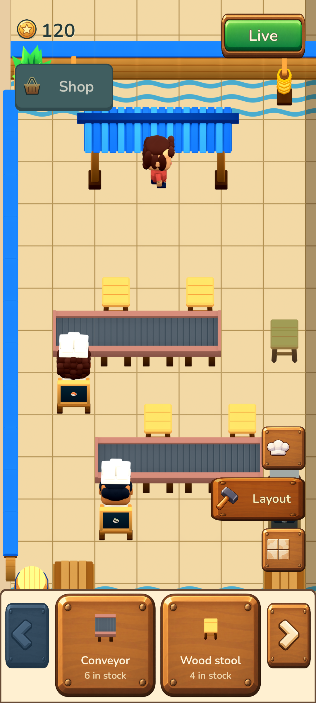
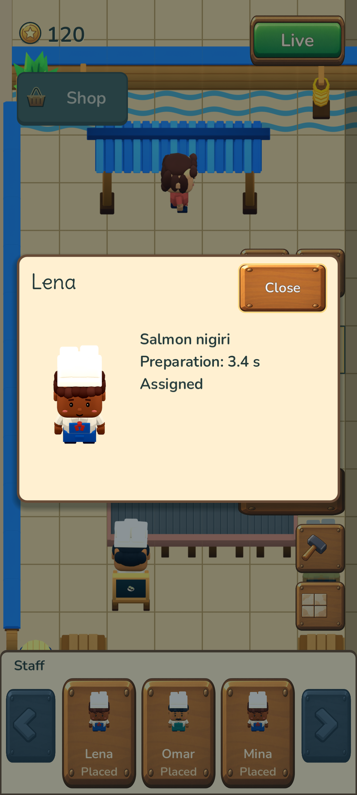

# Issue #12 — actual Android release verification

Both final release APKs use runtime commit `e405297e0a4eaa8f1778a51a84ec53909eb5e321`, Godot 4.7.2, version **0.4.0 / code 40**, the original release signer, Android minimum 24 / target 36, arm64 and x86_64, no permissions and no debuggable flag. The normal and isolated review apps have identical gameplay, content and asset sources. Only staged title/package settings differ.

| App | Package | APK SHA256 |
| --- | --- | --- |
| Normal update | `com.yiochen.sushilooptickets` | `ff411e9093829160c64cf7766088b7b9e9057046ca76d639b1b48bd76a6f486d` |
| Restaurant Editor review | `com.yiochen.sushilooptickets.review12` | `1f2ce2e75468dfe838e50690040053c1a8db8057f27a371218274929eebf01e3` |

The review APK is `build/sushi-loop-restaurant-editor-review-release-v0.4.0.apk`, **225,704,347 bytes**, MD5 `326aa740d5d31767377757f4422975d4`. This QA pass did not upload it. Exact source hashes and package audits are in [normal-build.json](normal-build.json), [review-build.json](review-build.json), [variant-parity.json](variant-parity.json) and [commit-runtime-verification.json](commit-runtime-verification.json). All **291** runtime source files match the frozen Git commit. The payload includes the 201 approved base atlases, separate food/reaction variants, and nine UI PNGs verified against eight retained ImageGen sources and the original restaurant catalog.

## Actual device interaction

[The Android report](android-editor-verification.json) and [input results](android-touch-qa.log) record **35 passing checks** using actual `adb input` taps, swipes and system key events against the signed release APKs. No gameplay state was injected into the new review app.

- Updated the existing normal 0.3.0 app to 0.4.0 in place. Primary and backup saves remained byte-identical before first launch; the existing eight-object restaurant, savings and camera were retained. The new review package was absent before installation and opened the two-counter starter at 120 coins.
- Entered Edit and confirmed every customer, chef, belt, timer, fractional clock and RNG remained paused. Selected the unused stool, rotated it, dragged it, rejected occupied/tray/layer-control drops atomically, removed it to inventory without a refund, then placed one owned stool by dragging from the tray.
- Used the two-item inventory paging rail, three-profile People tray, active-layer collapse, remembered Layout page and disabled Floor thumbnail. A single outside swipe deselected and panned continuously.
- Opened a chef profile and pressed actual Android **keyevent 4**. The popup closed, the process/PID remained alive, the exact paused Edit save was preserved and the layer controls were usable again. Back from the editor itself saved and exited.
- Verified Home, force-stop and Back reopening retain the exact paused restaurant, inventory, camera, selected layer, remembered page and tray state. Top-right Live resumed service. The normal app's primary and backup bytes remained untouched throughout review-app use.



Fifteen curated native screenshots cover the restored old restaurant, fresh review scene, editing, invalid drops, inventory, paging, roster, popup, disabled floor and reopening. Screenshots are unmodified 1080 × 2400 device captures.

## Full saved-state comparisons

[Five comparison results](continuation-reports.json) use the final production `GameSession` through its public restore/command/time/save boundary, with a numeric tolerance of `1e-7`. They compare **every saved field**, including RNG, customer choices/preferences, food ownership, timers, inventory and editor state:

1. Normal 0.3.0 → 0.4.0 migration and live continuation.
2. Paused Home return.
3. Paused force-stop reopening.
4. Paused Android Back reopening.
5. Explicit Live resume followed by normal service continuation.

The paired JSON files are actual synthetic restaurant data captured from this disposable emulator. [verify-continuation.gd](verify-continuation.gd) reproduces a comparison in the native project after import, for example:

```sh
godot --headless --path prototypes/sushi-loop/godot \
  --script res://review/12/android/verify-continuation.gd -- \
  prototypes/sushi-loop/godot/review/12/android/review-edit-back-before-reopen.json \
  prototypes/sushi-loop/godot/review/12/android/16-edit-back-reopened.json
```

Supply `resume` after the two file arguments when comparing the paused Back-reopened save with `review-live-after-edit.json`. The script reads only the supplied fixtures and does not open the application's real save directory.

## Emulator and runtime audit

Testing used an APFS clone of Pixel 8 / API 35 in a separate temporary AVD home, dedicated `emulator-5560`, `-read-only -no-snapshot-load -no-snapshot-save`, and isolated emulator settings. [The isolation receipt](avd-isolation.json) confirms the original AVD's config, base userdata, userdata overlay and snapshot metadata retained their exact SHA256, size and modification time. The disposable emulator was stopped without saving a snapshot. No physical devices, other app accounts or original AVD data were modified; no userdata image or signing key is included in this evidence.

[The filtered runtime log](runtime-logcat.txt) contains no Godot script errors or Android crashes. Two GLES shader-cache entries automatically recompiled after cold reopening; subsequent rendering was visually inspected successfully.
