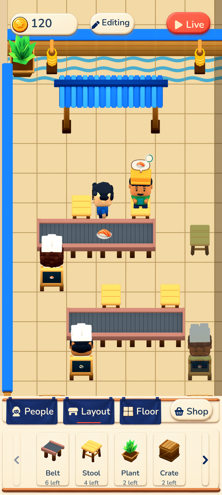

# Issue #12 noren revision — actual Android verification

The signed **0.4.2 / code 42** releases from runtime commit `8d6c6e1018571acfb8c2fad6d28aeb7dcc2040a0` passed **51 recorded Android assertions**. [The report](android-editor-verification.json), [summary](android-verification-summary.json) and [final audit](android-final-audit.log) cover actual touchscreen, system-key, background, cold-reopen and save comparisons. All **286 runtime source files** still match the exact release APK receipts after QA. No APK was built or uploaded by this QA pass.

| App | Package | APK SHA256 |
| --- | --- | --- |
| Normal update | `com.yiochen.sushilooptickets` | `534bab08ff60beb4495302d17d34439af9fc89911536a71b7f94f8a334bab5ac` |
| Restaurant Editor review | `com.yiochen.sushilooptickets.review12` | `3352df5217927c16fb9ef5520b677aac9e06610065724b38b99c9fdc2d883295` |

[APK preflight](apk-preflight.json), [normal](normal-build.json) and [review](review-build.json) receipts bind package, version and source metadata to those exact hashes. Both use the original pinned release signer, SHA256 `9b465ce9e19fc9cfb1a3a34c6fa2e1e452d3bfc9cb6adb5c01918c1fcfc061ed`, with no permissions or debuggable flag. Their shared runtime fingerprint is `38541c74c98175e1c4c8890bb7a8400b824e5794ccd95b31a7014bebde9a7ebe`.

Actual `adb input` touches and Android key events verified the revised editor:

- The rendered native screen shows independent looped curtains over the shared rod, cream through the seams, the bottom dock, four three-quarter Layout goods and narrow paging surfaces matching goods height/material. Coin, Editing, Live and Shop use the final 100-logical-pixel-height capsules. The native floor swatch visibly has tile thickness. [Visual observations](ui-visual-verification.json) record the inspected captures; final visual acceptance remains with the user.
- Held captures cover Edit, Shop, the pager, People and Live before their release actions. Dragging a People press outside and releasing cancels the action. For the critical background case, one continuous **30-second touch** remained down across Home and rendered same-PID resume. The People curtain returned to full size before the original touch released. That orphan release changed no saved field, layer or tray; a fresh People press worked. The [resumed-before-release](01d-people-background-resumed-before-release.png) and [orphan-released](01d-people-background-orphan-released.png) PNGs are byte-identical.
- Selected and rotated the disconnected stool, moved it onto clear floor, rejected occupied/tray/rail drops atomically, returned it to stock without a refund, then placed one owned stool from inventory. Four-good paging, three-profile People, disabled Floor, layer collapse, remembered Layout page and continuous deselect-and-pan passed.
- Actual Android Back closed the profile without exiting the app. Activating restored card focus reopened the profile; focused Close returned to the roster with readable text. Home, force-stop and Back reopening retained every saved paused field, including timers, RNG, inventory and camera. Every cold-reopen input/capture waited for two rendered-game observations, so the saved images show the game rather than the splash. Held Live retained the complete paused state until release, then resumed service.

The migration baseline was created by installing the old signed normal **0.4.1** app only in the disposable clone and using actual old-UI touches to save paused Layout page 1. No state was injected. The normal **0.4.1 → 0.4.2** installation preserved primary and backup bytes before first launch. Afterwards, every saved field matched except `editor_version` 2 → 3 and Layout page 1 → 0 for the three-to-four-slot mapping. The existing eight-object restaurant and economy were retained. See [old baseline](normal-v41-baseline.json), [old save](normal-v41-session-before-update.json), [migrated save](normal-v42-migrated.json) and [rendered migration](normal-v42-migrated-rendered.png).

The review package was absent before installation and opened its original 16-object starter at 120 coins. No review state was injected or reset. [The sandbox audit](sandbox-verification.json) verifies distinct Android UIDs/private package roots and confirms that the entire review run left normal primary and backup bytes unchanged.

One old QA drag coordinate landed within the revised context capsule's blocked rectangle. The app correctly rejected that release and preserved every saved field. The suite continued from that same paused save using a clear tile and an occupied tile outside the capsule; no runtime or APK changed. [Calibration details](qa-target-calibration.json) explain the coordinates.

- [Initial coordinate-calibration log](android-touch-qa.log): retains the Python QA wait timeout at the capsule-covered target. This phase ended before the remaining checks ran.
- [Successful continuation log](android-touch-qa-continuation.log): completes the clear-floor drag and remaining checks, ending with `51` checks and `passed: true`.
- [Final passing summary](android-verification-summary.json) and [full 51-assertion report](android-editor-verification.json): authoritative combined results for the exact APKs above.

[The runtime log](runtime-logcat.txt) contains **zero Godot script errors or Android crashes**. Two cold starts logged cached-shader recompilation warnings; rendering recovered and the actual cold-reopened screens were visually verified. No startup ANR occurred in this run.

[The isolation receipt](avd-isolation.json) records the separate APFS clone in `/private/tmp/sushi12-noren-review`, isolated AVD/emulator homes and dedicated `emulator-5560`, started only after the final sequential APK exports completed. It used `-read-only -no-snapshot-load -no-snapshot-save` and has exited without a snapshot save. The original AVD's config, base userdata, userdata overlay and snapshot metadata retain their exact SHA256, byte size and modification time. No physical device, other emulator or original AVD save was modified. This folder contains synthetic game QA PNG/JSON/log evidence and this README; no AVD userdata, signing key or credentials are included. Its 40 screenshots are unmodified 1080 × 2400 captures. [The manifest](evidence-manifest.json) records the evidence hashes.
