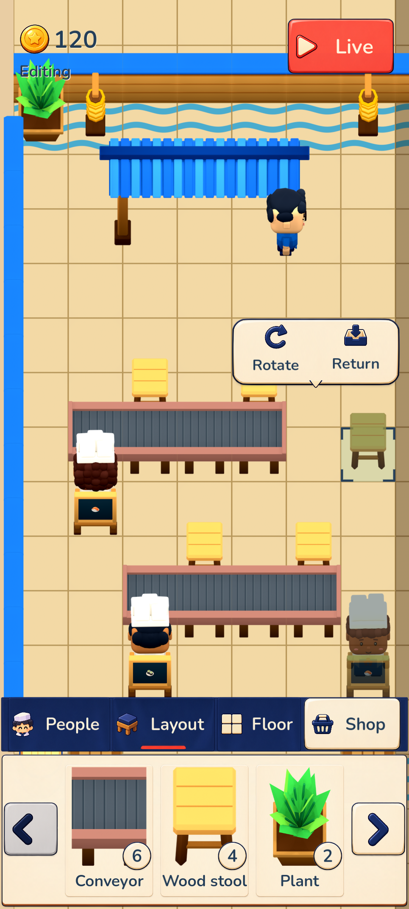
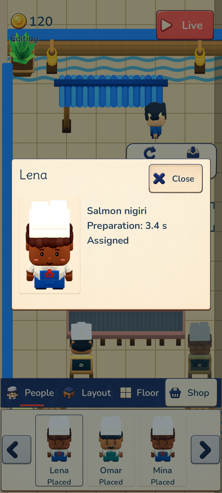

# Issue #12 B UI — actual Android release verification

The signed **0.4.1 / code 41** APKs from runtime commit `7c64d6fc483a561c2f6a78dff7f7c85ae32dc949` passed **49 recorded Android assertions**: [38 touch/save checks](android-editor-verification.json) and [11 additional lifecycle checks that wait for the game to render](android-ready-lifecycle-verification.json). [The combined summary](android-verification-summary.json) confirms that all **284 runtime source files** still match the release receipts after QA. This QA pass built and uploaded no APKs.

| App | Package | APK SHA256 |
| --- | --- | --- |
| Normal update | `com.yiochen.sushilooptickets` | `1ca268271fcce80fd0565d0d9bc2d76c0fbf978602a843c97ff40479d4ff2b09` |
| Isolated Restaurant Editor review | `com.yiochen.sushilooptickets.review12` | `de51b9bc8195ea03a94c5b100941812b9e7d4cefeb093200983dbe758e28de3f` |

[Normal](normal-build.json) and [review](review-build.json) receipts record the same runtime source files and original release signer, Android minimum 24 / target 36, arm64 and x86_64, no permissions and no debuggable flag. The isolated variant changes staged title/package settings.

Actual `adb input` taps, swipes and Android key events exercised the signed release on an isolated Pixel 8 / Android 15 emulator:

- Entered Edit and compared every saved field after a delay: customers, food, chef progress, timers, fractional clock and RNG remained paused. The horizontal People/Layout/Floor rail, cream drawer with three first-page Layout items, labeled Rotate/Return capsule, Live and Shop rendered together.
- Selected the disconnected stool, rotated and moved it, rejected occupied/tray/category-rail drops without changing the saved arrangement, returned it to inventory without a refund and dragged one owned stool back onto the floor. Paging, remembered Layout page, active-layer collapse, disabled Floor and continuous deselect-and-pan passed.
- Shop showed its unavailable feedback without mutating the paused restaurant. Opening a People profile preserved the exact save. Actual Android Back closed the popup and retained the app PID. Activating the restored card focus reopened the same profile; activating focused Close returned to the roster. The popup, focused Close text and restored card focus were visually inspected in [09c](09c-focused-profile-reopened.png) and [09d](09d-focused-close-activated.png).
- Home, force-stop and Back reopening retained every saved paused field. The final lifecycle run waited for the rendered coin and Edit Live control before comparison or further input. [Cold force-stop](20-ready-force-stop-reopened.png) and [Back reopening](21-ready-back-reopened.png) show the fully rendered paused editor. Live resumed the same restaurant from elapsed 8.15 to 8.8 seconds. Two earlier cold-reopen captures caught the splash; the repeated, rendered captures replace those images in this evidence set.

For migration, the old signed normal 0.4.0 app was installed only in the disposable clone. Actual old-UI touches created a paused Layout page-1 baseline; no state was injected. The in-place 0.4.0 → 0.4.1 installation preserved primary and backup bytes before first launch. After launch, every saved field matched except `editor_version` 1 → 2 and the documented two-slot page-1 → three-slot page-0 mapping. The existing eight-object restaurant and its economy were retained. See [the old baseline](normal-v40-baseline.json), [old save](normal-v40-session-before-update.json), [migrated save](normal-v41-migrated.json) and [rendered migrated restaurant](normal-v41-migrated-rendered.png).

The new review package was absent before installation and opened its original 16-object starter at 120 coins. No review gameplay state was injected. [The sandbox proof](sandbox-verification.json) records distinct Android UIDs and private package roots. Normal primary and backup bytes remained unchanged throughout all review interactions and the final rendered normal-app capture.

[The final runtime log](runtime-logcat.txt) contains **zero Godot script errors or Android crashes**. Five cold-start GLES shader-cache warnings reported recompilation; the game recovered and its rendered editor and Live frames were verified. Before the final suite, an Android System UI ANR dialog interrupted old-app baseline preparation after the emulator cold boot; dismissing that system dialog restored input. No app runtime failure occurred in the recorded release suite.

[The AVD receipt](avd-isolation.json) records a new APFS clone in `/private/tmp/sushi12-b-review`, separate AVD/emulator homes, dedicated `emulator-5560`, and `-read-only -no-snapshot-load -no-snapshot-save`. The clone emulator exited without saving a snapshot. The original AVD's config, base userdata, userdata overlay and snapshot metadata retain their exact SHA256, byte size and modification time. No physical device, other emulator or original AVD save was modified. This directory contains only synthetic game QA PNG/JSON/log evidence and this README; no AVD userdata, credentials or signing key is included. Screenshots are unmodified 1080 × 2400 captures. [The evidence manifest](evidence-manifest.json) records file hashes.
